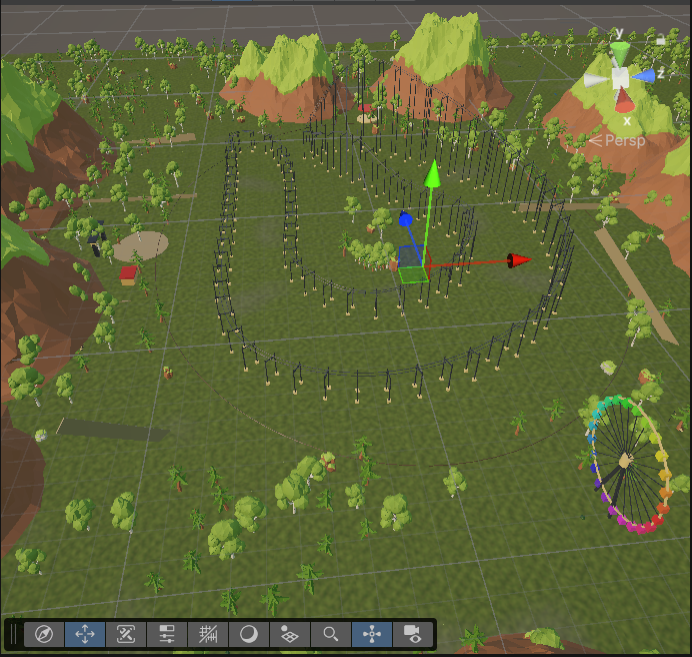
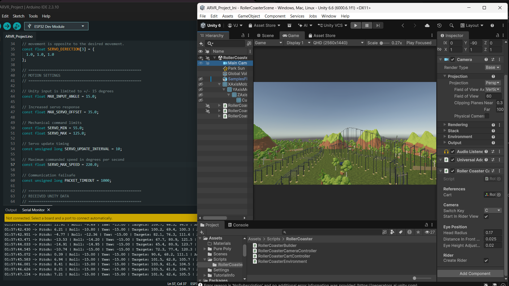
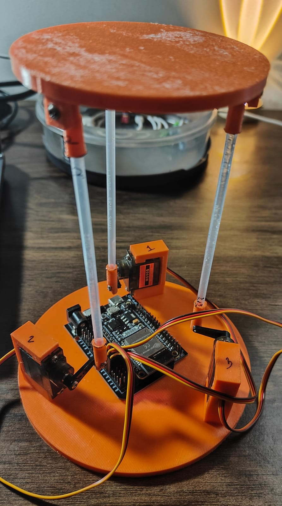
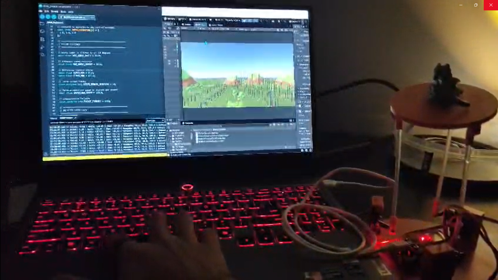

# 🎢 Roller Coaster Simulation – Unity 6

An interactive 3D roller coaster experience developed using **Unity 6.6**, featuring a custom track, animated coaster cart, immersive camera views, and ESP32-based hardware integration.

## Overview

This project recreates a roller coaster ride in a 3D environment. The cart moves along a custom-designed track featuring slopes, turns, drops, and elevation changes.

The Unity application also communicates with an ESP32 over Wi-Fi using UDP, transmitting motion data that can be used to control a physical three-servo platform.

## Features

- **Custom Roller Coaster Track** – A track featuring multiple turns, slopes, and elevation changes.
- **Dynamic Cart Movement** – A coaster cart that follows the track with changing speed and orientation.
- **First-Person Camera** – Experience the ride from the front seat.
- **Overview Camera** – Switch to an external view of the entire track.
- **3D Environment** – Detailed surroundings with terrain, vegetation, mountains, and scenery.
- **ESP32 Integration** – Wireless communication between Unity and ESP32 using UDP.
- **Motion Data Transmission** – Pitch, roll, and yaw values generated from the coaster's movement.

## Demonstration

### Roller Coaster Environment

The simulation features a custom-built track surrounded by a 3D environment.



### Software Integration

Unity communicates with the ESP32 through UDP, transmitting motion values during the simulation.



### Physical Hardware Prototype

The physical setup uses an ESP32 and three servo motors arranged in a three-degree-of-freedom platform.



### Complete Setup

The Unity simulation and physical hardware setup working together.



### Working Demo Video

[▶ Watch the Roller Coaster Demonstration](Documentation/Videos/roller-coaster-demo.mp4)

## Controls

| Key | Function |
|---|---|
| C | Toggle between first-person and overview camera |
| R | Toggle ESP32 home mode |

## Technologies Used

- Unity 6.6
- C#
- ESP32
- Arduino IDE
- UDP Communication
- Unity Input System
- SG90 Servo Motors

## Project Structure

```text
ARVR_Project/
│
├── Assets/
│   ├── Materials/
│   ├── Pure Poly/
│   ├── Scenes/
│   │   └── RollerCoasterScene.unity
│   └── Scripts/
│       ├── RollerCoaster/
│       │   ├── RollerCoasterBuilder.cs
│       │   ├── RollerCoasterCameraController.cs
│       │   ├── RollerCoasterCartController.cs
│       │   └── RollerCoasterEnvironment.cs
│       ├── CubeController.cs
│       └── ESP32UDPSender.cs
│
├── Documentation/
│   ├── Screenshots/
│   └── Videos/
│
├── Packages/
├── ProjectSettings/
└── README.md
```

## Getting Started

1. Clone or download this repository.
2. Install Unity 6.6 using Unity Hub.
3. Open the project through Unity Hub.
4. Navigate to `Assets/Scenes/RollerCoasterScene.unity`.
5. Open the scene and press **Play**.

## ESP32 Communication

The Unity application calculates the coaster's motion and transmits pitch, roll, and yaw values to the ESP32 over Wi-Fi using UDP packets.

The ESP32 receives these values and uses them to control the servo motors of the physical platform.

## Repository

[GitHub – ARVR_Project](https://github.com/VivanJ7/ARVR_Project)

---

*Built using Unity 6.6, C#, and ESP32.*
