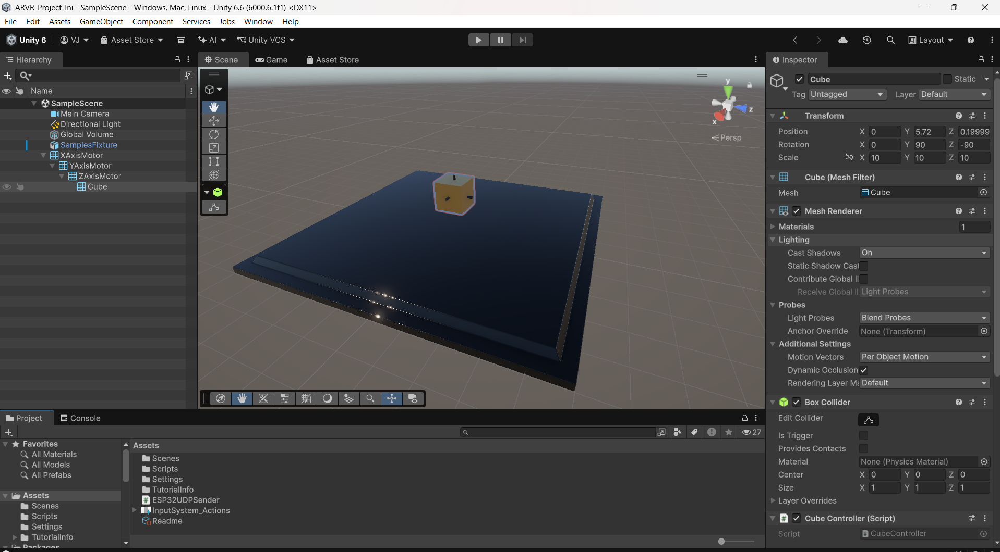
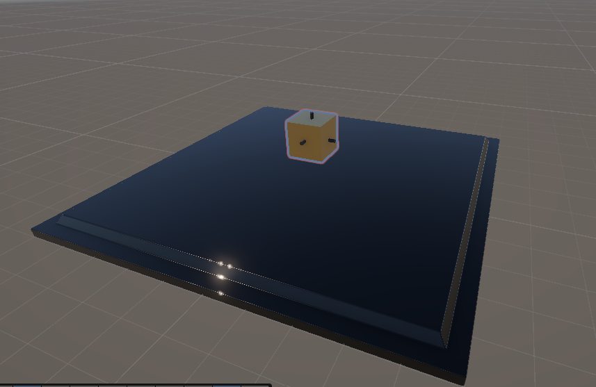

# AR/VR Project – Unity-Based Interactive Simulation

## Overview

This project is an academic AR/VR implementation developed using Unity 6 and C#. The project focuses on creating an interactive 3D environment in Unity and demonstrating real-time control of object orientation.

The Unity application communicates with an ESP32 over a network connection using UDP communication. The received orientation data can be used to control the physical prototype.

## Objectives

- Develop an interactive 3D simulation using Unity.
- Implement real-time rotation along the X, Y, and Z axes.
- Establish communication between Unity and an ESP32.
- Demonstrate UDP-based communication between the software and hardware.
- Integrate the Unity simulation with a physical prototype.

## Technologies Used

- Unity 6
- C#
- ESP32
- UDP Communication
- Visual Studio Code

## Project Features

- Interactive 3D object simulation.
- Rotation control along three axes:
  - X-axis
  - Y-axis
  - Z-axis
- Reset functionality to return the object to its original orientation.
- Unity-to-ESP32 communication using UDP.
- Hardware control through the ESP32.
- Demonstration of software-to-hardware interaction.

## Project Structure

```text
ARVR_Project_Ini/
│
├── Assets/
│   ├── Scenes/
│   ├── Scripts/
│   ├── Settings/
│   └── ESP32UDPSender.cs
│
├── Packages/
│
├── ProjectSettings/
│
├── Documentation/
│   ├── Screenshots/
│   └── Videos/
│
└── README.md
## Screenshots

### Unity Simulation



### 3D Environment



### Hardware Prototype


## Demonstration Videos

The project demonstrations are available in the `Documentation/Videos` folder.

- [Implementation Demo 1](Documentation/Videos/implementation_video_1.mp4)
- [Implementation Demo 2](Documentation/Videos/implementation_video_2.mp4)

## How to Run

1. Install Unity 6.
2. Clone this repository.
3. Open the project using Unity Hub.
4. Open the main scene:

   `Assets/Scenes/SampleScene.unity`

5. Enter Play Mode to run the Unity simulation.
6. For hardware communication, connect the ESP32 and configure the required network settings.

## Hardware

The hardware component uses an ESP32 to receive control information from the Unity application.

The physical prototype demonstrates the corresponding orientation movements generated by the Unity simulation.

## Documentation

Additional screenshots and demonstration videos are available in:

```text
Documentation/
├── Screenshots/
└── Videos/